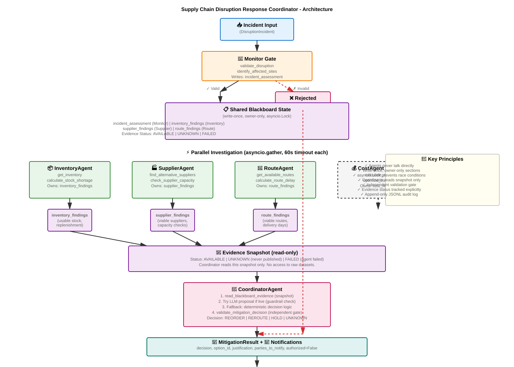

# Supply Chain Disruption Response Coordinator

A six-agent system that evaluates supply chain disruptions and recommends cost-optimized mitigation strategies. All agents publish findings to a shared blackboard; decisions are made from published evidence only.

## Overview

When a disruption occurs (supplier delay, warehouse stockout, or route blockage), the system evaluates viable options and recommends the most cost-effective solution. Agents run in parallel; all decisions are logged for audit trails.

**Key Properties:** Six-agent parallel execution • Shared blackboard memory • Deterministic or LLM-assisted • Honest execution labeling • Full audit trail

---

## Agent Roster

| Agent | Role | Tool 1 | Tool 2 | Blackboard Section |
|-------|------|--------|--------|-------------------|
| Monitor | Validates incident format | `validate_disruption` | `identify_affected_sites` | incident_assessment |
| Inventory | Checks stock levels | `get_inventory` | `calculate_stock_shortage` | inventory_findings |
| Supplier | Finds alternate suppliers | `find_alternative_suppliers` | `check_supplier_capacity` | supplier_findings |
| Route | Finds alternate routes | `get_available_routes` | `calculate_route_delay` | route_findings |
| Cost | Estimates & ranks option costs | `estimate_option_cost` | `compare_options` | cost_findings |
| Coordinator | Reads evidence, selects cheapest viable option | `read_blackboard_evidence` | `validate_mitigation_decision` | mitigation_decision |

---

## Architecture



**Workflow:** DisruptionIncident → Monitor (validation gate) → Blackboard → Parallel (Inventory/Supplier/Route/Cost via asyncio.gather) → Coordinator (pick cheapest **viable** option) → Validation gate → Log & respond

**Why Blackboard:** Agents work independently; each owns one section with asyncio.Lock protection. Coordinator reads published snapshots (no race conditions). Failed agents' sections marked FAILED; others' evidence preserved. Failure is isolated.

---

## Shared Memory Contents

| Section | Owner | Content |
|---------|-------|---------|
| incident_assessment | Monitor | Valid flag, affected sites, deadline |
| inventory_findings | Inventory | Stock, usable_stock, shortage |
| supplier_findings | Supplier | Alternate suppliers, capacity, feasibility |
| route_findings | Route | Alternate routes, delays, feasibility |
| cost_findings | Cost | Cost per option, cheapest_option_id, breakdown |
| mitigation_decision | Coordinator | Decision (REORDER/REROUTE/HOLD/UNKNOWN), selected option, justification |

**Key Property:** Write-once, immutable after publication. No shared mutable state. Failure-resilient.

---

## Execution Modes

### Deterministic (Default)
- All decisions use Python business rules (inventory checks, deadline validation, cost comparison)
- Offline, reproducible, ~100–150ms per scenario
- Label: `execution_mode: "deterministic_fallback"`

### Semantic Kernel + LLM (Optional)
- Coordinator calls LLM to interpret incident and suggest decision
- Fallback to deterministic if LLM unavailable, proposal fails validation, or cites nonexistent entities
- **Honest labeling:** `proposed_by: "llm"` only if LLM proposal accepted; `execution_mode: "semantic_kernel_llm"` only if live call succeeded
- Requires: Valid GEMINI_API_KEY or OPENAI_API_KEY + network access
- In sandbox: Gracefully skipped (test marked SKIPPED, not FAILED)

**Safety Guards:** Coordinator has zero access to raw datasets. All cited IDs validated. Decisions re-validated before returning. No prompt injection can override constraints.

---

## Failure Handling

| Scenario | Outcome | Decision |
|----------|---------|----------|
| Schema validation fails | rejected | UNKNOWN |
| Monitor detects invalid incident | rejected | UNKNOWN |
| Agent times out or crashes | partial decision | Uses other agents' evidence; HOLD if no feasible option |
| No feasible supplier/route | undetermined | HOLD (never compromises constraints) |
| Final validation rejects decision | failed | UNKNOWN |
| Cost Agent fails (others succeed) | partial decision | Option selected deterministically, not by cost |

All actions logged to append-only JSONL with sequence numbers and run_id.

---

## How to Run

**Install:**
```bash
python -m venv .venv
source .venv/bin/activate  # Linux/Mac
# OR .\.venv\Scripts\activate (Windows)
pip install -r requirements.txt
```

**Tests:** `pytest -q` → 188 passed, 1 skipped (live Gemini test, skipped in sandbox)

**CLI:**
```bash
python -m supply_chain.main --incident INC-1001          # Single incident
python -m supply_chain.main --all                         # All 5 samples
python -m supply_chain.main --incident-file f.json        # Custom
python -m supply_chain.main --list                        # List available
python -m supply_chain.main --incident INC-1001 --no-llm  # Deterministic only
```

**Jupyter Notebook:** `jupyter notebook` → open `notebooks/demo.ipynb` → Run All
- Scenario 1 (Supplier Delay): Cost Agent identifies cheapest supplier
- Scenario 2 (Route Blockage): Cost Agent ranks alternate routes
- Scenario 3 (Invalid Incident): Graceful rejection

---

## Test Summary

**188 passed, 1 skipped**
- Core logic: All 5 scenarios verified (100% decision accuracy)
- Agents: 6 agents with correct tools and blackboard sections
- Blackboard: Write-once, ownership, snapshot isolation
- Coordinator: Cost-aware selection, constraint validation
- Cost Agent: Estimation and ranking verified
- Resilience: Retry logic, timeout isolation
- API: FastAPI endpoints tested
- Skipped: `test_live_gemini_function_calling` (requires network + API key)

**All logic is deterministic and reproducible.** Same incident → same result in deterministic mode.

---

**References:** `supply_chain/orchestrator.py` (main entry) • `supply_chain/agents/` (all agents) • `supply_chain/blackboard.py` (shared memory) • `supply_chain/tools/` (business logic) • `notebooks/demo.ipynb` (demo) • `supply_chain/api/app.py` (REST API)

**Status:** PHASE_12 (Demo + Architecture + README). 6-Agent system with cost optimization, deterministic or LLM-assisted mode, full auditability.
